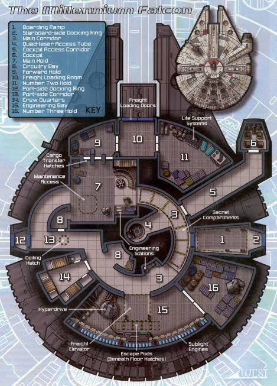
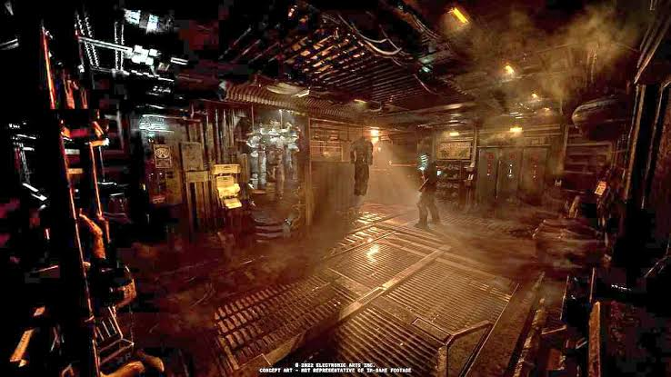
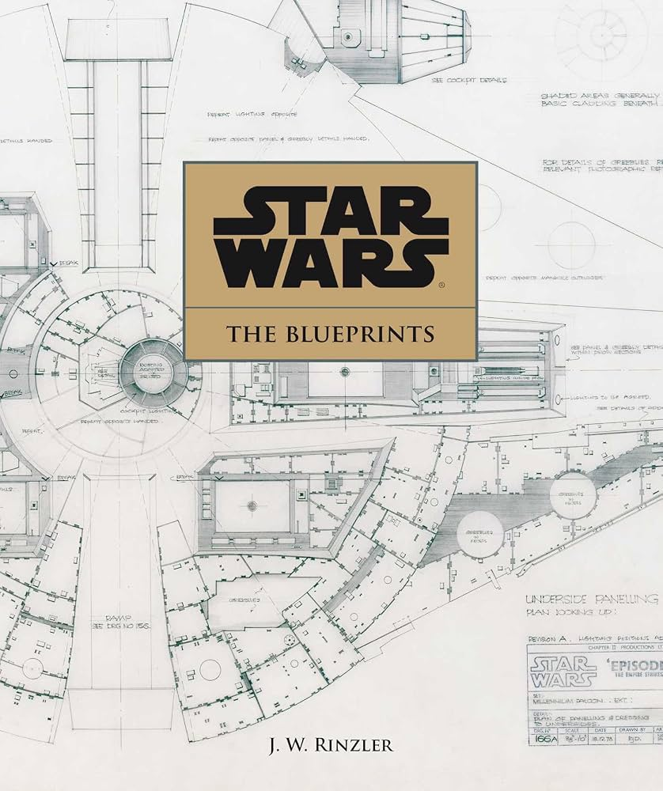

# Procedural Sci-Fi Corridor and Tunnel Generator

## Project Overview

In this project, a procedural modular sci-fi corridor and tunnel system will be created using Blender Geometry Nodes.

The environment blends:

1. Structured, hard-surface architectural paneling
2. Complex procedural greebles such as wiring, cooling pipes, structural support ribs, and recessed lighting strips

Only the interior structure and immediate modular elements of the facility will be modeled.

The resulting corridor system will be a parametric 3D model, controllable by exposed node parameters (such as segment length, pipe density, and corridor curvature/path deformation).

The resulting parametric corridor generator will be used to construct a multi-junction underground sci-fi facility layout.

## Visual Inspiration

| Inspiration 1 | Inspiration 2 |
| :-- | :-- |
|  |  |

## Milestone 1: Primary Structural Shell

In the first milestone, the base architectural shell of the corridor (walls, floor, and ceiling plates) will be created.

The structure consists of flat paneling, bevels, and recessed geometric frames. These elements form the main structural volume of the tunnel.

To create these elements, procedural hard-surface modeling techniques and Geometry Nodes will be used. A base curve or linear mesh array will drive the instancing and repetition of the corridor segments.

I found good inspiration for this in the official Star Wars Blueprints artbook (https://www.youtube.com/watch?v=HPkdqXe-Ufw).

**Useful Tutorials:**

- Blender Procedural Corridor Tutorial: https://www.youtube.com/watch?v=HPkdqXe-Ufw

**Parametric Controls:**

- **Corridor Segment Count / Length:** Controls the repeating length of the tunnel along the guide path.
- **Corridor Width & Height:** Adjusts the interior dimensions and proportions of the wall and floor panels.
- **Panel Bevel / Inset Depth:** Controls the hard-surface detail depth on the primary wall and ceiling panels.

## Milestone 2: Secondary Elements & Procedural Greebles

In the second milestone, organic-like technological detailing and secondary greeble elements will be added to the corridor interior.

These elements include interlocking support ribs, wall/ceiling wiring conduits, complex piping networks, and recessed emission lighting strips.

To create these elements, procedural curve-to-mesh techniques, noise-based displacement, and random point distribution will be used. Pipes and cables will follow procedural curve paths along the interior walls, while lights and support beams instance dynamically along segment intervals.

I found good inspiration for this in the official Deadspace artbook (https://www.youtube.com/watch?v=lIN-yFzu37k).

**Useful Tutorials:**

- Procedural Cables and Pipes in Blender: https://www.youtube.com/watch?v=lIN-yFzu37k

**Parametric Controls:**

- **Pipe & Cable Density:** Controls the total count and clustering of exposed wall/ceiling pipes.
- **Greeble Seed / Randomization:** Seed value to dynamically alter cable routing, panel variations, and detail positions.
- **Curvature / Path Twist:** Bends, tilts, or warps the corridor trajectory along custom curve inputs.

## Milestone 3: Facility Layout & Multi-Corridor Junctions

In the third milestone, the resulting parametric corridor system will be used to construct a complex underground facility or spaceship section.

Multiple instances of the corridor generator with different parameter settings (varying lengths, densities, and turns) will be combined with custom junction hubs (T-crossings, four-way intersections, and airlocks) to form a cohesive, fully detailed 3D environment.

Rendered camera passes with atmospheric volume fog and dynamic lights will be set up to showcase the parametric variability of the final generator.
